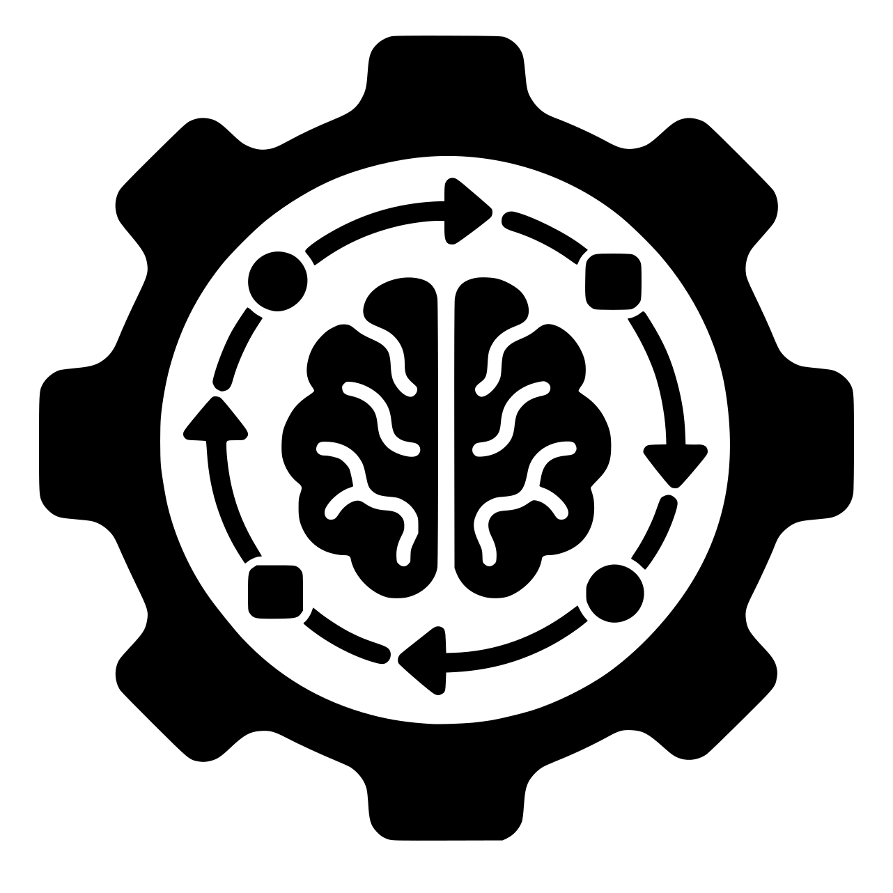

# BenchKeeper

BenchKeeper keeps the agent's workbench in order: the rules, skills and tools Claude Code and Codex work with, installed at pinned versions and checked on every `/global-setup` run. The bench is shared by every project; each repository gets its own container and spec setup on top.

Global agent setup for Claude Code and Codex: rules, two skills, rebuild steps.

Claude Code and Codex are independently optional. Setup detects installed agents and asks which you use. Only selected agents receive configuration, plugins, hooks, and skills. Agent CLIs are not installed by setup; unused or absent agents are skipped.

## Contents

| Path | What | Linked as |
|---|---|---|
| [rules/global.md](rules/global.md) | global rules | `~/.claude/rules/00-global.md` (symlink); copy in `~/.codex/AGENTS.md` |
| [skills/global-setup](skills/global-setup/SKILL.md) | install, check, and clean the global setup (all commands) | `~/.claude/skills/`, `~/.agents/skills/`, and in this repo |
| [skills/project-setup](skills/project-setup/SKILL.md) | set up or update one repo: AGENTS.md, stack skills, LSP, OpenSpec or Spec Kit, codegraph | `~/.claude/skills/`, `~/.agents/skills/` |

## Components

| Component | Scope | Purpose |
|---|---|---|
| [Dev Containers](https://code.visualstudio.com/docs/devcontainers/devcontainer-cli) | tooling on host, configuration per repo | agents run on the host; project commands run inside the container |
| [Ponytail](https://github.com/DietrichGebert/ponytail), level `full` | global, Claude + Codex | implementation simplicity within agent-skills phases |
| [agent-skills](https://github.com/addyosmani/agent-skills) | global, Claude + Codex | workflow: spec, plan, TDD, review, ship |
| [OpenSpec](https://github.com/Fission-AI/OpenSpec) | CLI global, wired per repo | spec files (owns the artifacts; agent-skills drives the process, [#166](https://github.com/addyosmani/agent-skills/issues/166)) |
| [Spec Kit](https://github.com/github/spec-kit) | CLI global, wired per repo | alternative to OpenSpec, chosen per repo in `project-setup`; owns the spec files, agent-skills drives the process |
| [codegraph](https://github.com/colbymchenry/codegraph) | CLI global, wired per repo | code index + MCP |
| [RTK](https://github.com/rtk-ai/rtk) | global, Claude + Codex | condensed command output |
| [Context7 MCP](https://github.com/upstash/context7) | global, Claude + Codex | library docs |
| [Playwright MCP](https://github.com/microsoft/playwright-mcp) | project connections, container browsers | browser checks |
| [find-skills](https://github.com/vercel-labs/skills) | global | skill search, used by `project-setup` |
| LSP `pyright-lsp`, `typescript-lsp` | host plugins, container servers | diagnostics after `project-setup` verifies the connection and file paths |

Per repo (committed when applicable to selected agents): `.devcontainer/`, `AGENTS.md`, `CLAUDE.md`, `.agents/skills/`, `.claude/skills/`, `skills-lock.json`, `openspec/` or `.specify/` and `specs/`, `.mcp.json`, `.codex/config.toml`. Not committed: `.codegraph/`.

Ponytail and agent-skills remain separate plugins. [Global rules](rules/global.md#ponytail-and-agent-skills) integrate them: agent-skills drives the workflow; Ponytail `full` guides implementation within agreed scope, architecture, and required checks. Integration changes live here, not in installed plugin files. Select another Ponytail mode when needed.

## Telemetry

| Tool | Setting |
|---|---|
| Claude Code | `DISABLE_ERROR_REPORTING=1`, `CLAUDE_CODE_DISABLE_FEEDBACK_SURVEY=1` |
| Claude Code, not set | `DISABLE_TELEMETRY`, `DO_NOT_TRACK`, `CLAUDE_CODE_DISABLE_NONESSENTIAL_TRAFFIC`: they disable feature flags, so the advisor and Remote Control stop working ([docs](https://code.claude.com/docs/en/env-vars)) |
| Codex | `[analytics] enabled = false` |
| RTK, OpenSpec, codegraph | off |
| skills CLI | `DO_NOT_TRACK=1` per command only |

## Prerequisites

Not installed by BenchKeeper; see each official page.

| Tool | Needed for |
|---|---|
| [Claude Code](https://code.claude.com/docs/en/setup) | agent (one or both) |
| [Codex CLI](https://developers.openai.com/codex/cli) | agent (one or both) |
| [Git](https://git-scm.com/downloads) | clone, branches, commits |
| [GitHub CLI](https://cli.github.com/) | issues and pull requests (optional, local branches without it) |
| [Node.js and npm](https://nodejs.org/en/download) | global CLIs, prefix `~/.local` |
| [uv](https://docs.astral.sh/uv/getting-started/installation/) | Spec Kit |
| [jq](https://jqlang.org/download/), [curl](https://curl.se/download.html) | setup scripts |
| [Docker Engine](https://docs.docker.com/engine/install/) | devcontainers |
| [VS Code](https://code.visualstudio.com/download) | optional, attach to the devcontainer |
| [Orca](https://onorca.dev) | optional, parallel agents |

## Setup steps

1. Install the [prerequisites](#prerequisites): at least one agent you use, plus the tools for the steps you apply. npm uses prefix `~/.local`, no sudo.
2. Clone to `/mnt/data/Projects/benchkeeper`, open it in Claude Code or Codex.
3. Run `/global-setup` (Codex: `$global-setup`). Confirm which installed agents you use. It checks applicable parts, installs what is missing after confirmation, and proposes cleanup only within that scope. All commands are in [skills/global-setup/SKILL.md](skills/global-setup/SKILL.md).
4. Restart selected agents; if Codex is selected, run `/hooks` and trust the plugin hooks.
5. Java LSP, when Claude Code is selected: `project-setup` installs the JDK and server inside the project container and verifies the host plugin connection.

Rerun `/global-setup` after editing `rules/global.md` (Codex gets a copy, not a link).

## Per repo

Run `/project-setup` (Codex: `$project-setup`). Confirm the agents used for this project. New repo: sets up. Existing setup: updates and cleans selected integrations. Commit the result. Fresh clone: use `project-setup` to restore skills for selected agents from their recorded sources.

Agents run on the host and use standard devcontainers for project commands. `global-setup` configures host agent tooling, checks host Docker, and installs the pinned Dev Containers CLI; `project-setup` creates or updates the repository's container and project toolchain. Agent authentication, BenchKeeper, global rules, and skills stay on the host. Rootless engines, VMs, and microVMs are not required.

- CLI or an Orca worktree terminal: start the container with `devcontainer up --workspace-folder .`, then launch `claude` or `codex` on the host.
- VS Code may attach to the same container for project terminals, builds, and debugging. Keep the agent in a host terminal.
- Route project dependency installs, builds, lint, tests, and local MCP/browser tools through `devcontainer exec --workspace-folder . ...`. Host file inspection, edits, and Git operations remain available. Container startup failures stop dependent commands; they do not trigger a host fallback. Native chat and extension execution locations need separate verification.
- Project MCP/browser and language-server connections need verified container launchers and file paths. A host plugin or binary installation alone does not establish container execution; unsupported connections are reported as unavailable.

Launch commands: [Dev Containers CLI](https://code.visualstudio.com/docs/devcontainers/devcontainer-cli), [VS Code](https://code.visualstudio.com/docs/devcontainers/containers). The setup policy scopes mounts to the project and excludes host homes, engine sockets, privileged mode, and credential forwarding. Client defaults need checking; VS Code can forward Git credentials and SSH agents automatically. [Credential sharing](https://github.com/microsoft/vscode-docs/blob/main/remote/advancedcontainers/sharing-git-credentials.md)

The agent remains a host process with access governed by its client permissions. The devcontainer scopes project commands and their mounts; it does not isolate the host agent. [Container security](https://docs.docker.com/engine/security/)

## Update

- Plugins: run `claude plugin marketplace update` only for selected Claude Code, `codex plugin marketplace update` only for selected Codex (not pinned).
- CLIs and MCPs: `/global-setup` compares the pinned versions with the latest releases and proposes bumps before installing.
- Repo skills: use `project-setup` to update selected skills and agent placements.

## Optional: Orca

[Orca](https://github.com/stablyai/orca) ([onorca.dev](https://onOrca.dev)): desktop app to run and orchestrate parallel agents (Claude Code, Codex) with your own subscriptions; desktop, mobile, remote. The application is installed separately, not by `/global-setup`.

`/global-setup` asks before installing the optional `orca-cli` and `orchestration` skills globally for selected agents only. Declining skips installation without failing setup. Existing Orca skills and hooks are kept. See [setup part 12](skills/global-setup/SKILL.md#12-orca-skills-optional-ask) and [Orca's skill installation instructions](https://github.com/stablyai/orca/blob/main/docs/site/content/docs/cli/skills.mdx).
