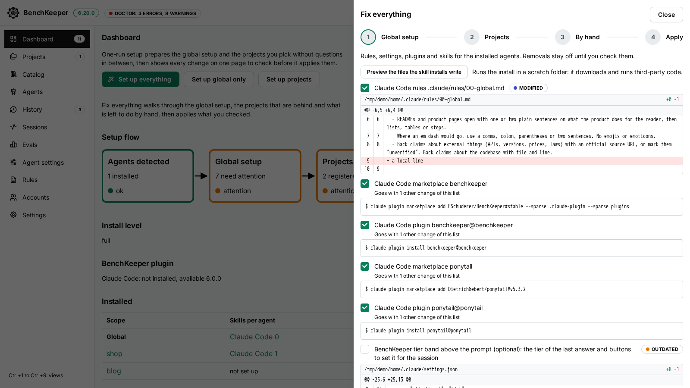

<p align="center"></p>

# BenchKeeper

<!-- generated:description -->
BenchKeeper sets up Claude Code and Codex the same way on your machine and in each repository: short global rules and a workflow skill that sizes each task, plus a dev container, `AGENTS.md` and skills at pinned versions per repository. Its app shows every change before it applies it and records each run so you can undo it.
<!-- /generated:description -->

For developers who run Claude Code or Codex in more than one repository and want the same rules, skills and dev container setup in each.

## Install

<!-- generated:quickstart -->
Node.js 22 and at least one agent, Claude Code or Codex ([full list](docs/setup.md#prerequisites)). Choose the App to review each change in the browser. Choose the CLI in a terminal-only session or in a script.

### App

```sh
npx benchkeeper@6.20.0
```

Opens the browser on the Dashboard with the doctor findings. Select Fix everything, review the changes and press Apply; nothing is written before.

### CLI

```sh
npx benchkeeper@6.20.0 plan
```

Lists each change and writes nothing.

```sh
npx benchkeeper@6.20.0 apply
```

Asks per change. `--yes` applies the default selection without questions.

After either path, restart the agents. `npx benchkeeper@6.20.0 history` lists what changed, `npx benchkeeper@6.20.0 undo <run>` reverses a run.

[Lite level, the plugin alone](docs/setup.md#levels). [Full setup description](docs/setup.md#setup-details).
<!-- /generated:quickstart -->

If `npx` cannot find that version, run the app from a clone: [steps](docs/setup.md#setup-details). Linux and macOS are tested. Windows runs only a CI smoke test.

## Every change is shown first

<picture>
  <source media="(prefers-color-scheme: dark)" srcset="web/public/app/fix-dark.png">
  
</picture>

Fix everything shows each file change as a diff and each command as its command line, and writes nothing until you press Apply. The screenshot uses example data. [Every view of the app](https://eschuderer.github.io/BenchKeeper/app/).

## More

- [Project site](https://eschuderer.github.io/BenchKeeper/): the workflow, the install levels and the app
- [Setup guide](docs/setup.md): prerequisites, levels, what a full `apply` writes, per-repository setup, updates, undo
- [Accounts](docs/setup.md#accounts): several Claude Code and Codex logins, signed in through private browser windows, on the host and in dev containers
- [Stack](docs/stack.md): components, repository map, how the stack was chosen, optional tools
- [App reference](app/README.md): every command and the web UI
- [Benchmarks](https://eschuderer.github.io/BenchKeeper/bench/): score and time per setup on one shared brownfield task
- [Security notes](docs/security.md) and [how to report a vulnerability](SECURITY.md)
- [Changelog](CHANGELOG.md) and [issues](https://github.com/ESchuderer/BenchKeeper/issues)

## License

[MIT](LICENSE)
